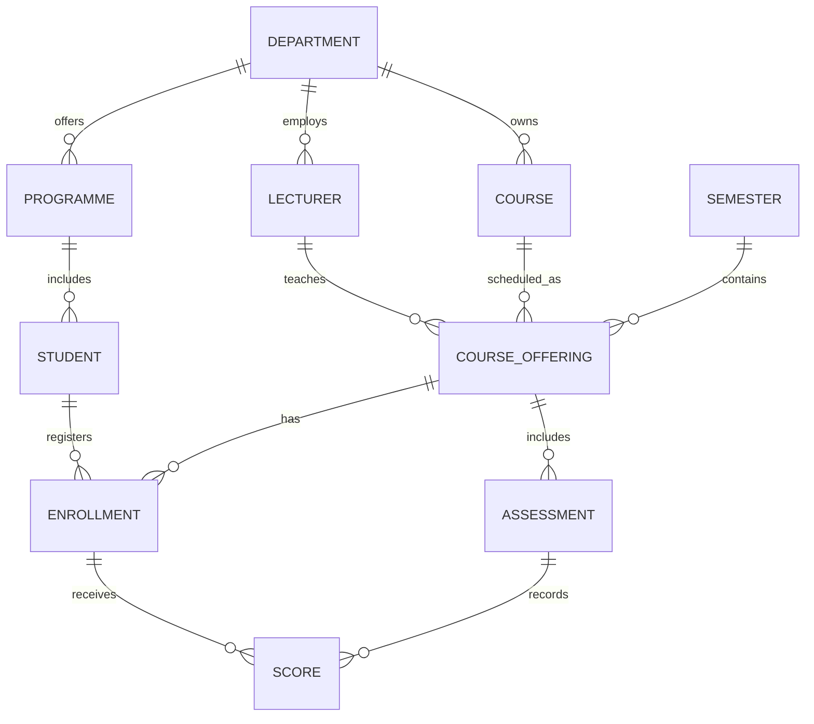

# ER model - University Results Portal

## Relationship notes
- A course offering is one delivery of a course in a semester and section.
- Enrollment links one student to one offering; the pair is unique.
- Assessment belongs to one offering. Score connects an enrolled student and an assessment within the same offering.
- This model can calculate weighted results from the score records. It does not yet encode the university's grade bands or GPA rules.
