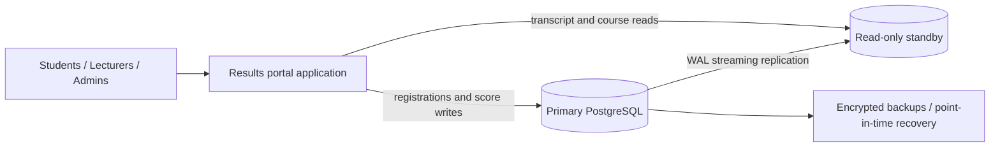

# Portfolio 5 - Distributed and Cloud Design

## Scenario
The fictional university results portal has one authoritative PostgreSQL primary. Students generate many transcript reads around result-release periods, while lecturers and administrators write registrations and scores. The design below is a proposal, not a deployed system.

## Replication and availability
A primary with a warm standby can improve recovery time after a primary failure. PostgreSQL streaming replication is asynchronous by default, so a recent commit can take a short time to appear on the standby. If the primary fails before the standby receives those changes, some recent commits can be missing after failover. For the portal, route grade submission and immediate post-submission confirmation reads to the primary. Route ordinary transcript reads to the standby only when a small replication delay is acceptable. Synchronous replication can reduce this data-loss risk by waiting for standby acknowledgement on commits, at the cost of write latency and dependence on standby/network availability. See the PostgreSQL [warm standby and streaming replication documentation](https://www.postgresql.org/docs/current/warm-standby.html).

A real deployment also needs monitored replication lag, tested failover procedures, backups stored separately from the primary, restore drills, role-based access, TLS, and audit logging. Replication is not a substitute for backups: accidental changes can also replicate.

## Distribution and growth
The first scaling step is a read replica because result retrieval is read-heavy during release periods. If the `scores` table becomes very large, partitioning by semester or academic year can make old-result maintenance more manageable and may help queries that filter by the partition key. Partitioning divides a logical table within the PostgreSQL cluster; it does not itself distribute data across independent servers. PostgreSQL supports range, list, and hash partitioning; see its [table partitioning documentation](https://www.postgresql.org/docs/current/ddl-partitioning.html).

Sharding across independent database nodes would require a shard key, such as `student_id` or a combination of programme and student. Student-key sharding keeps a student's transcript on one shard, but cross-shard reports and department-wide queries become more complex. Avoid sharding until monitoring shows that one primary plus read replicas and partitioning cannot meet the workload.

## Consistency and deployment choice
Use the primary as the source of truth for grade writes, registration decisions, and any read that must immediately reflect a just-committed update. Read replicas can serve slightly stale data under asynchronous replication. A managed cloud PostgreSQL deployment could provide a primary, a standby in a separate availability zone, backups, and monitoring, while the application connects through a private network. The operator must still configure access controls, backups, recovery goals, and test failover; managed hosting does not remove those responsibilities.

## Evidence and limitations
This portfolio item is a design discussion only. No cloud resources, replicas, or shards have been provisioned. If the lecturer expects a practical setup, create a small local two-instance demonstration or use an approved cloud account and include genuine configuration and output evidence. Do not publish credentials or live student information.

## References
- PostgreSQL Documentation, "Log-Shipping Standby Servers": https://www.postgresql.org/docs/current/warm-standby.html
- PostgreSQL Documentation, "Table Partitioning": https://www.postgresql.org/docs/current/ddl-partitioning.html
